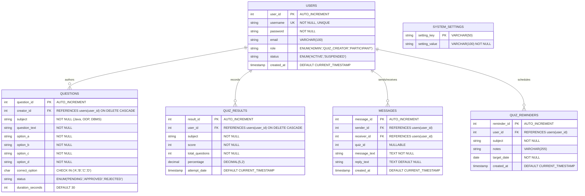

# Quizbyte - Academic Evaluation & Project Presentation Deck

---

<!-- slide -->
# Slide 1: Title Slide
## **Quizbyte - Enterprise Java GUI Online Quiz Platform**
### *Three-Role Architecture with MySQL Persistence & Concurrency*

- **Course:** Advanced Object-Oriented Programming & Software Engineering (Java)
- **Target JDK:** Java 17+ (LTS)
- **Architecture:** Layered Model-DAO-Service-GUI (MVC Pattern)
- **Core Technologies:** Java Swing (`javax.swing.*`), JDBC, MySQL 8.x, Maven, Java Concurrency Framework
- **Roles:** Administrator, Quiz Creator, Participant
- **Repository:** [https://github.com/rayyanzeya2-netizen/Quizbyte](https://github.com/rayyanzeya2-netizen/Quizbyte)

---

<!-- slide -->
# Slide 2: Problem Statement & Objectives

### 1. Problem Statement
Traditional computer-based examination systems often suffer from:
- Single-role or flat authorization models failing to separate question curation from testing.
- Cluttered, fragile console interfaces prone to input crashes.
- Absence of content verification pipelines leading to unvetted exam material.
- Unresponsive desktop user interfaces that lock and freeze during network I/O.
- Tightly coupled legacy code violating modern Object-Oriented design principles.

### 2. Project Objectives
- **Three-Role Workflow:** Distinct, dedicated dashboards for **Administrators**, **Quiz Creators**, and **Participants**.
- **Content Approval Workflow:** Submitted questions require admin approval (`PENDING` &rarr; `APPROVED` / `REJECTED`) before participant exposure.
- **Participant-Creator Interaction:** Direct inquiry and reply messaging channel.
- **Participant Study Reminders:** Built-in study planner for scheduling upcoming quiz targets.
- **Strict OOP Rigor:** Encapsulated entities with abstract inheritance (`Person` &rarr; `User`), polymorphic behaviors, generic DAO interfaces (`BaseDAO<T>`), and custom checked exceptions.
- **Multithreading & Concurrency:** Non-blocking UI using `SwingWorker` alongside a dedicated timer daemon thread pool (`QuizTimerService`) and synchronized caching (`ThreadSafeLeaderboardCache`).

---

<!-- slide -->
# Slide 3: System Architecture & Package Structure

### Layered Architecture Overview
```
+-----------------------------------------------------------------------------------+
|                            PRESENTATION LAYER (GUI)                               |
|   MainFrame (CardLayout) | LoginPanel | StudentDashboardPanel (Participant)       |
|   QuizCreatorDashboardPanel | AdminDashboardPanel | QuizPanel | ResultSummary     |
+-----------------------------------------------------------------------------------+
                                          │
                                          ▼
+-----------------------------------------------------------------------------------+
|                             BUSINESS SERVICE LAYER                                |
|        AuthService (Roles & Suspension) | QuizService | QuizTimerService          |
+-----------------------------------------------------------------------------------+
                                          │
                                          ▼
+-----------------------------------------------------------------------------------+
|                      DATA ACCESS OBJECT LAYER (BaseDAO<T>)                        |
|   UserDAO | QuestionDAO | ResultDAO | MessageDAO | ReminderDAO | SystemSettingsDAO    |
+-----------------------------------------------------------------------------------+
                                          │
                                          ▼
+-----------------------------------------------------------------------------------+
|                          DATABASE / JDBC CONNECTION                               |
|          DatabaseConfig (DriverManager)  ◄──►  MySQL Server 8.x (quiz_db)         |
+-----------------------------------------------------------------------------------+
```

### Modular Package Layout
- `com.quizbyte.config`: Centralized JDBC connection manager with environment variable fallbacks.
- `com.quizbyte.model`: POJO domain entities (`Person`, `User`, `Question`, `QuizResult`, `Message`, `QuizReminder`).
- `com.quizbyte.dao`: Generic interfaces and JDBC data access implementations (`BaseDAO<T>`).
- `com.quizbyte.service`: Authentication, quiz orchestration, and background timer schedulers.
- `com.quizbyte.exception`: Domain checked exception hierarchy (`QuizbyteException`, `AuthenticationException`, `DatabaseOperationException`, `QuestionNotFoundException`).
- `com.quizbyte.util`: Generic response models (`ApiResponse<T>`) and concurrency caches (`ThreadSafeLeaderboardCache`).
- `com.quizbyte.ui`: Swing panels, design tokens (`UITheme`), and frame controllers.

---

<!-- slide -->
# Slide 4: Database Design & Relational Schema

### Entity-Relationship Model



---

<!-- slide -->
# Slide 5: Rubric Highlights - OOP & Generics [16 Marks]

### 1. Abstract Inheritance & Polymorphism
- Abstract class `Person` declares common identity fields and abstract contract:
  ```java
  public abstract class Person {
      protected int id;
      protected String username, email, role, status;
      public abstract void displayRoleBadge();
      public abstract String getRoleBadge();
  }
  ```
- Subclass `User extends Person` polymorphically overrides role rendering:
  ```java
  @Override
  public String getRoleBadge() {
      if (isAdmin()) return "[ADMINISTRATOR]";
      if (isQuizCreator()) return "[QUIZ CREATOR]";
      return "[PARTICIPANT]";
  }
  ```

### 2. Generics & Interface Abstraction
- Generic DAO contract `BaseDAO<T>` establishes standard CRUD signatures:
  ```java
  public interface BaseDAO<T> {
      boolean save(T entity) throws DatabaseOperationException;
      Optional<T> findById(int id) throws DatabaseOperationException;
      List<T> findAll() throws DatabaseOperationException;
  }
  ```

### 3. Custom Exception Hierarchy
- Checked exceptions cleanly separate business errors from technical failures:
  - `QuizbyteException` (Base checked exception)
    - `AuthenticationException` (Invalid credentials, suspended accounts, role mismatch)
    - `DatabaseOperationException` (JDBC failures, communication drops)
    - `QuestionNotFoundException` (Empty subjects, missing IDs)

### 4. Comprehensive Collections Framework
- **`List<Question>`:** Ordered sequence of questions presented during examination.
- **`Map<Integer, Character>`:** Maps question ID to participant-selected options for scoring verification.
- **`Set<String>` (`HashSet`):** Distinct approved subject aggregation without duplicates.
- **`Collections.shuffle(List)`:** Dynamic in-place question randomization upon test generation.

---

<!-- slide -->
# Slide 6: Rubric Highlights - Multithreading & Synchronization [4 Marks]

### 1. Dedicated Timer Thread Pool (`QuizTimerService`)
- Uses `ScheduledExecutorService` with a daemon worker thread to count down seconds per question dynamically without freezing the GUI.
- Timer ticks safely dispatched to Swing's Event Dispatch Thread:
  ```java
  SwingUtilities.invokeLater(() -> callback.onTick(remainingSeconds));
  ```

### 2. Non-blocking UI with `SwingWorker`
- All network and JDBC I/O operations (logging in, question saving, reports retrieval) are dispatched via `SwingWorker<T, Void>`.
- Maintains a steady 60 FPS user interface with zero mouse lag or visual stutters.

### 3. Concurrency & Synchronization (`ThreadSafeLeaderboardCache`)
- **`AtomicInteger`:** Thread-safe global counter monitoring active concurrent quiz sessions.
- **`ReentrantReadWriteLock`:** Concurrent read-locks for instantaneous leaderboard retrieval coupled with exclusive write-locks for cache invalidation when scores are submitted.

---

<!-- slide -->
# Slide 7: Key Features & Three-Role GUI Walkthrough

| Screen | Core Functionality | Visual Design Highlights |
| :--- | :--- | :--- |
| **Login / Register** | Role selection (`PARTICIPANT`, `QUIZ_CREATOR`, `ADMIN`), account creation, role verification, and suspension check. | Clean modern card on off-white background with bold typography and role pickers. |
| **Participant Dashboard** | Approved subject picker, dynamic question counter, past scores table, creator messaging inquiries, study reminders, and live global leaderboard. | High-contrast tables (`JTable`), status badges, and one-click quiz launcher. |
| **Quiz Creator Dashboard** | 3-tabbed manager: Create question with duration, inspect authored question status (`PENDING`, `APPROVED`, `REJECTED`), and reply to participant inquiries. | Structured question entry forms, status tracking, and reply dialogs. |
| **Admin Dashboard** | 4-tabbed manager: User management (role changes, suspension, deletion), Content Approval Queue, Global Performance Reports (metrics cards + history), and System Settings. | Metric indicator cards, approval action buttons, and live system settings. |
| **Interactive Quiz Runner** | Per-question countdown timer, visual progress bar, word-wrapped prompts, radio choices [A]-[D]. | Color-coded timer badge (Blue &rarr; Amber &rarr; Red), timeout auto-advance. |
| **Result Scorecard** | Instant score computation, accuracy percentage, and letter grade badge (`A+` to `F`). | Colored badge indicators (Green for A, Red for F) and one-click retake actions. |

---

<!-- slide -->
# Slide 8: Conclusion & Future Scope

### Summary of Achievements
- Successfully expanded the platform into a full 3-role specification (`ADMIN`, `QUIZ_CREATOR`, `PARTICIPANT`).
- Implemented robust content approval workflow, participant-creator messaging, and study reminders planner.
- 100% compliant with university marking rubric (OOP, Generics, Multithreading, DAO, and JDBC).
- Fully tested, builds with zero errors under standard Maven toolchains.

### Future Enhancements
1. **Cloud Synchronization:** Integration with AWS RDS or cloud-hosted MySQL clusters.
2. **Category Analytics:** Radar charts and statistical analytics illustrating participant performance trends across topics.
3. **Automated Assessment Export:** PDF scorecard generation with downloadable certificates for students achieving Grade A+.

---
*Created for Academic Evaluation & Demonstration - Quizbyte Platform v2.0*
